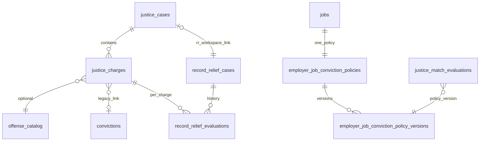

# Canonical member justice schema (reconciliation)

**Status:** Design + proposed migration only — **not applied** to shared DEV Supabase.

## Decision: one member case/charge model

| Layer | Tables | Role |
|-------|--------|------|
| **Canonical (member)** | `justice_cases`, `justice_charges` | Single docket + counts for Opportunity Profile, Record Relief, matching, disclosure |
| **Legacy (read + backfill)** | `convictions`, `record_relief_cases` | Kept until backfill completes; **no new parallel charge rows** |
| **Reference (Record Relief)** | `record_relief_jurisdictions`, `record_relief_rules`, `record_relief_courts`, `record_relief_local_filing_profiles` | Verified legal reference; not member PII |
| **Evaluations (versioned)** | `record_relief_evaluations` (+ `justice_charge_id`) | Append-only history per charge (and optional case rollup) |
| **Employer (published)** | `employer_job_conviction_policies`, `employer_job_conviction_policy_versions` | Job-specific criteria; admin-gated publish |
| **Matching (explainable)** | `justice_match_evaluations` | Outcome + criteria refs only — never full charge text |

### Rejected duplicate

`record_relief_charges` (draft 23100000) is **not** created. Charge columns live on **`justice_charges`** so Record Relief and Profile do not maintain two charge stores.

## Entity relationships

## Field ownership (charges)

| Concern | Stored on `justice_charges` |
|---------|----------------------------|
| Multi-count / mixed disposition | `count_number`, `disposition` per row |
| Amended charges | `amended_from_charge_id`, `statute_code`, `statute_version` |
| Classification | `degree`, `degree_level`, `offense_category`, `offense_catalog_id` |
| Sentence dates | `conviction_date`, `disposition_date`, `sentence_completion_date`, … |
| Provenance | `source_type`, `verification_state`, `source_reference` |
| Sealed / expunged | `visibility` (`member`, `sealed`, `expunged`, `sealed_pending_verification`) — excluded from employer matching RPCs |
| Corrections | `justice_charge_corrections` append-only |

## Consumer mapping

| Consumer | Reads |
|----------|--------|
| My Justice Records | `justice_cases` + `justice_charges` + latest non-superseded `record_relief_evaluations` |
| Record Relief workspace | Same rows via `record_relief_cases.justice_case_id`; engine input = `CaseBundle` from charges |
| Opportunity Profile / questionnaire | One `origin=questionnaire` charge via RPC sync to `justice_charges` (replaces lone `convictions` row over time) |
| Job matching | Security-definer RPC: charge fact summaries + approved `policy_version_id` only |
| Partner policy editor | RPC `partner_save_job_conviction_policy_draft` / `partner_submit_job_conviction_policy` |
| Admin | RPC `admin_review_job_conviction_policy`; `admin_audit_log` |

## Interim (pre-migration) app behavior

Until migration applies, mobile uses **`assembleUnifiedJusticeCases()`** (convictions + `record_relief_cases`) and **`jobs.eligibility_rules.justice_policy_v1`** with Partner/Admin guards in server actions — **not** database-enforced.

## Authoritative migration file

`docs/proposed-migrations/20261021150000_canonical_justice_reconciliation_DRAFT.sql` supersedes:

- `20261023100000_record_relief_charge_venue_engine_DRAFT.sql` (courts/filing portions merged; RR charges dropped)
- `20261021140000_unified_justice_employer_policies_DRAFT.sql` (merged + RPCs + triggers)

See **`docs/JUSTICE_LEGACY_BACKFILL_PLAN.md`** for data preservation steps.
