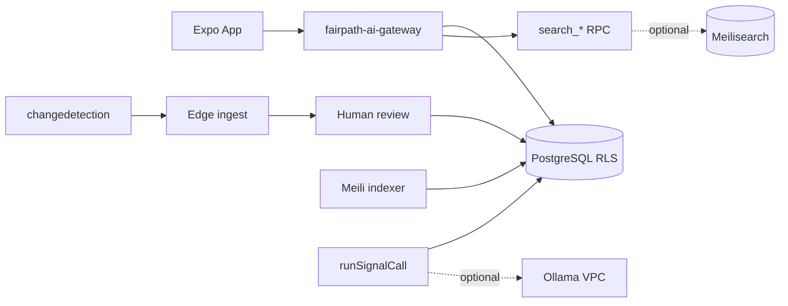

# FairPath open-source implementation roadmap

**Baseline:** `3dc4e45` · **iPhone build:** `e52815e1` · **Metro:** `:8083` (do not duplicate)

## 30 days — stabilize + monitor

| Week | Deliverable | Owner | Gate |
|------|-------------|-------|------|
| 1 | **iPhone acceptance** — complete checklist, update `DEV_IPHONE_JOURNEY_RESULTS.md` | Human + device | P0 release |
| 1 | DEV **`ANTHROPIC_API_KEY`** (optional) in Edge secrets for non-fallback Signal copy | Ops | No prod |
| 2 | Deploy **changedetection.io** on isolated VPS; webhook to DEV Edge stub | Eng | No auto-publish |
| 2 | Map catalog URLs → monitors (`authoritative-catalog.json`) | Eng | Legal/license review |
| 3 | Document resource review queue UX (staff) for diffs | Product | — |
| 4 | Re-run `Run-DevAuthenticatedQa.mjs` after any Edge change | CI | 122/122 |

**Prototype (done):** `scripts/poc/postgres-search-latency-probe.mjs` → `scripts/poc/postgres-search-latency-results.json`

## 60 days — search + documents

| Item | Action |
|------|--------|
| Meilisearch | DEV index sync job (service role); A/B vs `search_resources` relevance suite |
| Gateway | Keep orchestration; add search tool to query Meili **via Edge** if A/B wins |
| Record Relief | Stirling-PDF sidecar for merge/split; synthetic PDF tests only |
| OCR | Spike Tesseract in `extract-record-relief-case` worker path |
| Metabase | Read-only connection to Supabase replica; partner KPI dashboards |

## 90 days — inference + national ops

| Item | Action |
|------|--------|
| Ollama | DEV VPC adapter behind `runSignalCall` for `member_signal` fallback tier |
| Routing | OpenRouteService isochrone prototype for transportation resources |
| InvenTree | Evaluate only if Food Rescue SKU tracking exceeds current schema |
| Kestra/Activepieces | Adopt **one** if cron/workflow complexity exceeds Supabase pg_cron |

## Integration architecture (reference)

## Build vs buy vs self-host (decisions)

| Capability | Decision |
|------------|----------|
| Member data | **Buy/host Supabase** — keep |
| Signal orchestration | **Build** (gateway) — keep |
| Full-text search | **Build** (RPC) now; **self-host Meili** if metrics justify |
| LLM | **Buy** API default; **self-host Ollama** optional tier |
| URL monitoring | **Self-host changedetection** |
| Partner BI | **Self-host Metabase** or Supabase reports |
| PDF ops | **Self-host Stirling-PDF** worker |
| Mobile maps | **Buy** Google (Android) / Apple Maps |

## iPhone acceptance gate (independent track)

Until `DEV_IPHONE_JOURNEY_RESULTS.md` has pass/fail for all items:

- DEV login, GPS allow/deny, ZIP fallback  
- Signal multi-need + cards + routes  
- My Path save, force-close, cloud persistence  
- Keyboard, tabs, scroll  

**Open-source milestones do not substitute for this gate.**

## Prototype log

| Date | POC | Environment | Result |
|------|-----|-------------|--------|
| 2026-10-26 | Postgres search latency | DEV linked | p50 118–145 ms |
| — | Meilisearch index | Not started | Blocked: no DEV cluster |
| — | changedetection webhook | Not started | Architecture only |
| — | Ollama adapter | Not started | No GPU on Mini PC |

## Commits (research tranche)

- Open-source docs + `scripts/poc/postgres-search-latency-probe.mjs` on `development/mobile-v1-completion`
