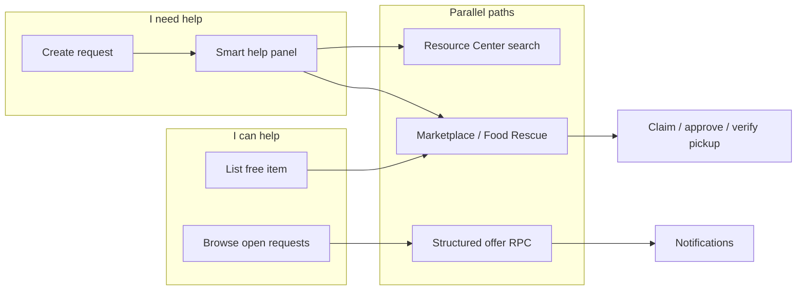

# Unified Community Exchange — Forensic Audit & Integration Map

**Mission:** GIVE + Marketplace + Food Rescue + Resource Center + Community Requests  
**Date:** 2026-10-21  
**Scope:** `fairpath-mobile` (full). Partner (`quindad-fairpath-partner`) and Admin (`fairpath-admin`) were not present in this workspace; Partner/Admin sections reflect migration/RPC inventory only.

**Gates preserved:** Professional Profile migration `20261021190000_profiles_professional_network_DRAFT.sql` and Canonical Justice migration `20261021150000_canonical_justice_reconciliation_DRAFT.sql` remain **unapplied**.

---

## Executive summary

| Surface | Status | Notes |
|---------|--------|-------|
| Free Marketplace (GIVE) | **Working E2E** | Claims, approval, pickup codes, quota via `counts_toward_quota`, RLS, mobile screens |
| Food Rescue | **Partial** | UI filters `is_food_rescue` listings; member bulk posting removed; `src/core/food/inventory.ts` unused client rules |
| Resource Center | **Working E2E** | `search_resources` RPC, ZIP/radius, guest-safe |
| Community requests (“I need help”) | **Missing → proposed** | New draft migration `20261021180000_community_help_exchange_DRAFT.sql` + mobile (local) |
| Need ↔ offer matching | **Partial** | Client matching + structured offers RPC; pickup reuses Marketplace when linked |
| QR pickup | **Missing** | Numeric pickup code only |
| Member resource referrals | **Missing** | Partner CRM referrals require org case link (`participant_needs` / `referrals`) |
| Home orchestration | **Was disconnected** | Jobs-heavy; marketplace in summary but not in `nextSteps` — **patched** |
| Justice / Opportunity Profile isolation | **Must hold** | No justice fields on community paths; no profile snapshot on requests |

---

## Mobile — tables & RPCs (existing)

### Marketplace
- **Tables:** `marketplace_items`, `marketplace_claims`, `marketplace_messages`, `marketplace_pickup_details`, `marketplace_reports`, `marketplace_media`, `marketplace_saves`
- **Key RPCs:** `request_marketplace_claim`, `approve_marketplace_claim`, `verify_marketplace_pickup`, `marketplace_claim_quota`, `send_marketplace_pickup_message`, `set_marketplace_item_availability`
- **Quota rule:** `marketplace_claim_quota` counts rows where `counts_toward_quota = true` (successful/completed paths set this; declined/cancelled pre-approval do not)
- **Screens:** `/marketplace`, `/marketplace-list-item`, `/marketplace-claims`, `/food-rescue`, claim/manage flows
- **Tests:** `scripts/audit-marketplace.mjs`, `scripts/test-local-marketplace.mjs`

### Resources
- **Migration:** `20261001100000_resources_core.sql`
- **RPC:** `search_resources`
- **Screens:** `/resources`, `/resource/[id]`, saved resources
- **Tests:** `scripts/audit-resources.mjs`, `scripts/test-local-resources.mjs`

### Notifications
- **Table:** `user_notifications` (inserted from marketplace RPCs)
- Community help draft migration follows the same pattern for offer/accept events

---

## Mobile — proposed (community help)

- **Draft migration:** `docs/proposed-migrations/20261021180000_community_help_exchange_DRAFT.sql`
- **Tables:** `community_help_requests`, `community_help_offers`
- **RPC-only writes** (no direct authenticated INSERT on tables)
- **Privacy:** Board RPC exposes category, description, urgency, city/state — not member_id; full row owner-only
- **Local harness:** `scripts/test-local-community-help.mjs` (applies draft after baseline migrations)

---

## Workflow map

**Distinct lanes (do not merge):**
- **Community exchange** — neighbor GIVE + lightweight requests (no case file)
- **Public resource** — directory + guest search
- **Formal referral** — Partner CRM (`referrals` tied to `participant_needs` + org relationship)
- **Sponsored program** — eligibility on program record only

---

## Partner / Admin (repository inventory)

### Partner (`20261006100000_partner_referral_crm_core.sql`)
- Referrals created by org staff with existing case-management link — **not** member-initiated from Resource Center today
- **Recommendation:** Member “request referral” → new RPC in a **separate** migration after product/legal sign-off; reuse `referrals` table shape

### Admin
- Marketplace moderation via existing item `moderation_status` and `marketplace_reports`
- Resource moderation in resources migrations
- **Recommendation:** Extend existing moderation queues for unsafe food flags (marketplace report reasons) rather than new admin app

---

## Reuse vs new

| Capability | Reuse | New |
|------------|-------|-----|
| Free item offers | Marketplace create/list/claim | Food safety copy + validation module |
| Food near you | `food-rescue.tsx` + `is_food_rescue` | Stricter V1 food categories in UI |
| Find services | `searchResources` | Smart help wiring on request detail |
| Pickup handoff | Marketplace claim + code | QR — not in V1 |
| Community requests | — | Draft SQL + `/community/*` screens |
| Need/offers | Notifications pattern | `community_help_offers` RPCs |

---

## Test matrix (Phase 16)

| Flow | Coverage |
|------|----------|
| A Marketplace pickup | `test-local-marketplace.mjs` |
| B Need + resources + offers | `tests/community-smart-help.test.ts`, `test-local-community-help.mjs` |
| C Resource search | `test-local-resources.mjs` |
| D Partner referral | **Blocked** — no member RPC |
| E Report listing | Marketplace report insert |
| F Cross-member privacy | Community RLS tests in local harness |
| G No justice data | `tests/community-privacy.test.ts` (static) |
| H Profile isolation | Static audit — no opportunity imports on community screens |
| I Quota on failed pickup | `test-local-marketplace.mjs` declined/cancelled cases |

---

## Next GO actions

1. **Approve** `20261021180000_community_help_exchange_DRAFT.sql` for shared DEV (after review).
2. Partner: member-initiated resource referral RPC + inbox UI (separate mission).
3. Admin: confirm marketplace report queue covers “unsafe food” reason copy.
4. Optional: geospatial radius for marketplace (today city/ZIP text).
5. QR pickup — product/security review before implementation.
