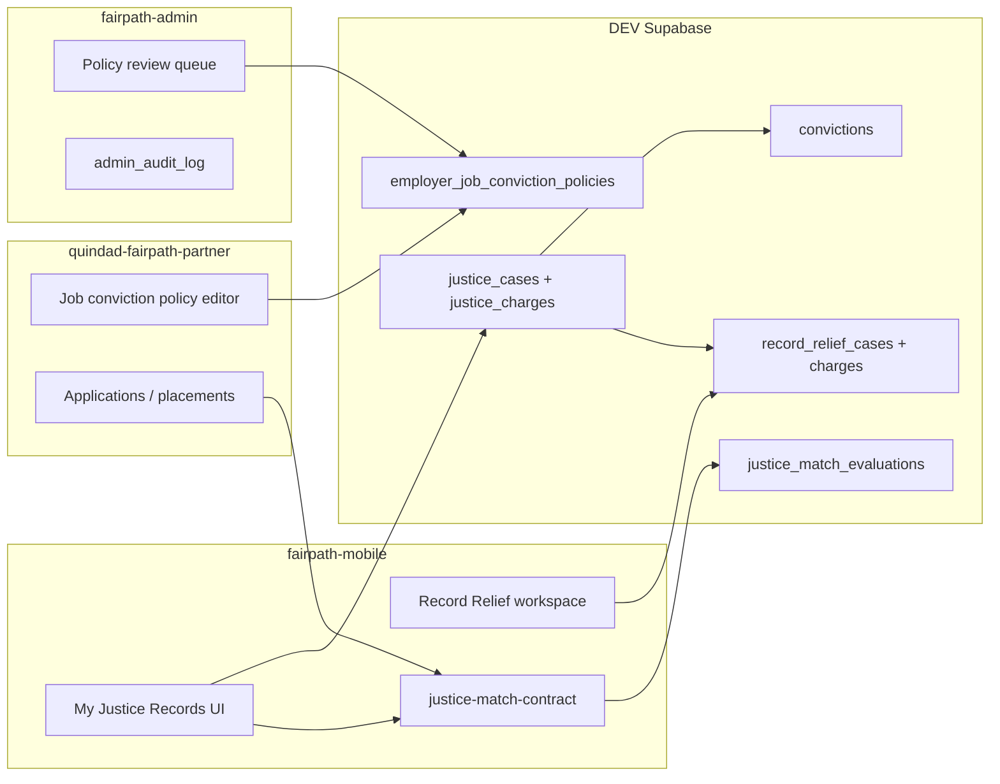

# Unified Justice Intelligence — cross-repository integration map (Phase 1)

**Date:** 2026-10-21 · **Environment:** DEV only · **Status:** inventory + local contracts (no migrations applied)

## Repository roles

| Workflow | Owner repo | Primary surfaces | DEV schema / code |
|---|---|---|---|
| Member criminal history (canonical) | **fairpath-mobile** (schema in `supabase/migrations`) | Opportunity Profile, future My Justice Records | `convictions`, `offense_catalog`, `offense_taxonomy_categories` |
| Record Relief cases & evaluations | **fairpath-mobile** | `/record-relief/*`, Edge `evaluate-record-relief` | `record_relief_*`, 57 TS jurisdiction adapters in `src/core/record-relief/` |
| Job search & apply | **fairpath-mobile** | `/find-jobs`, Easy Apply | `jobs`, `job_applications`, `submit_job_application` |
| Fair-chance / conviction matching (client logic) | **fairpath-mobile** (shared contract copied to Partner/Admin) | Job detail insights (planned), staffing | `src/core/matching/fair-chance.ts`, `job-conviction-match.ts`, `justice-match-contract.ts` |
| Employer ATS & job management | **quindad-fairpath-partner** | `/jobs`, placements, retention | Same Supabase project; RLS via `organization_id` + `organization_members` |
| Staff RBAC & audit | **fairpath-admin** | Orgs, moderation, audit log | `staff_users`, `admin_audit_log`, `src/lib/authz.ts` |
| Organization capabilities | **fairpath-mobile** (schema) | Partner workspace sections | `organization_capabilities` (`employment`, `housing`, `case_management`) |
| Incentive / program matching | **fairpath-mobile** (schema) | Economic opportunities, Partner job page hints | `opportunity_matches`, `incentive_programs` |
| Consent & disclosure | **fairpath-mobile** | `/privacy`, apply flows | `consent_events`, `justice_history_disclosure_consent` |
| Housing justice fields | **fairpath-mobile** | Housing apply / screening copy | `housing_listings.eligibility_rules`, `housing_applications` secure RPCs |

**Note:** Admin and Partner are **separate Next.js apps** on the same DEV Supabase project. They do **not** ship duplicate migration folders; **fairpath-mobile** is the migration source of truth.

## Data-model gaps (verified)

1. **`convictions`** — one row ≈ one charge; rich provenance; **no FK** to `record_relief_cases`.
2. **`record_relief_cases`** — one row ≈ one charge today; full RR UI; **`caseToCaseBundle()`** emits a single charge.
3. **`record_relief_charges`** — **draft only** (`docs/proposed-migrations/20261023100000_record_relief_charge_venue_engine_DRAFT.sql`); not applied.
4. **`jobs.eligibility_rules`** — JSONB seed metadata (`conviction_policy`, `excluded_categories`, `waiting_years`); **not** a versioned employer policy table; mobile filter uses `second_chance_evidence` only.
5. **`evaluate_justice_eligibility` RPC** — planned in convictions migration comment; **not implemented**.
6. **`opportunity_evidence`** — service-role only; tags external/local listings with fair-chance evidence; not employer-authored job policies.

## Target architecture (Phases 2–7)

Until migrations apply, the **unified read model** (`src/core/justice/unified-assembly.ts`) merges `convictions` + `record_relief_cases` in application code without a third store.

## Shared dependency contract

- **Package name (logical):** `@fairpath/justice-match-contract`
- **Source of truth:** `fairpath-mobile/src/core/matching/justice-match-contract.ts`
- **Mirrors (must stay byte-identical until npm workspace):**
  - `quindad-fairpath-partner/src/lib/justice-match-contract.ts`
  - `fairpath-admin/src/lib/justice-match-contract.ts`

## DEV database

- Mobile QA doc references project `znvhmuhojvwvjzmaqwff` (Round 6).
- Admin/Partner `.env.local` should point at the **same** project for integrated testing; **not verified in this pass** — confirm before cross-app E2E.

## Canonical schema (reconciled 2026-10-21)

Single proposal: **`docs/proposed-migrations/20261021150000_canonical_justice_reconciliation_DRAFT.sql`**

- **`justice_cases` + `justice_charges`** = only member charge store (no `record_relief_charges` table).
- Legacy: `convictions.justice_charge_id`, `record_relief_cases.justice_case_id`, `record_relief_evaluations.justice_charge_id`.
- Backfill: **`docs/JUSTICE_LEGACY_BACKFILL_PLAN.md`**
- Approval gate: **`docs/JUSTICE_MIGRATION_APPROVAL_CHECKLIST.md`**

## Approval gates (stop lines)

| Item | Needs approval |
|---|---|
| Apply reconciled canonical justice migration (DEV) | Founder + backend + counsel |
| Publish employer policies to Mobile matching | Admin review workflow live |
| Production deploy / git push | Explicit user request |
